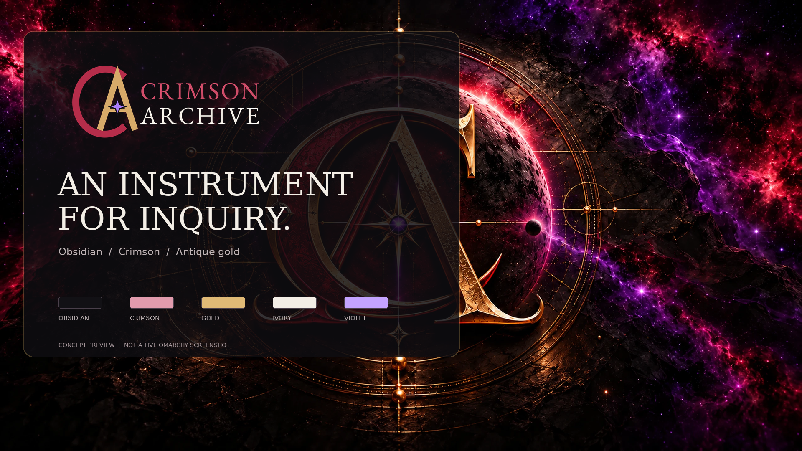

# Crimson Archive — Omarchy Theme

**Obsidian. Crimson. Antique gold. A desktop for serious work.**

Crimson Archive is an Omarchy / Hyprland theme based on the **Crimson Archive Complete Brand Kit v3.0**. It combines obsidian panels, warm ivory text, crimson selection, deliberate gold focus states, and an optional ANSI ultraviolet role. The package includes no fonts or executable setup scripts.



## Installation

### Install from GitHub

From an Omarchy terminal, install the theme from its public repository:

```bash
omarchy theme install https://github.com/calebaiken/omarchy-crimson-archive-theme
```

Omarchy installs the theme as `crimson-archive` and activates it. To select it later or confirm the active theme:

```bash
omarchy theme set crimson-archive
omarchy theme current
```

### Manual installation with GitHub MFA

Browser-based download is an alternative for GitHub accounts that use multifactor authentication (MFA), or when Git access is unavailable.

1. Sign in to GitHub in a browser and complete the MFA challenge.
2. Open the [Crimson Archive repository](https://github.com/calebaiken/Omarch-Crimson-Archive-Theme), select **Code → Download ZIP**, and extract the archive on the Omarchy system.
3. Open a terminal in the extracted folder (many file managers provide **Open in Terminal** from the folder's context menu), or change to that folder in an existing terminal.
4. Confirm the terminal is in the theme folder, then copy the files into Omarchy and activate the theme:

   ```bash
   source_dir="$PWD"
   test -f "$source_dir/colors.toml" || { echo "Run this from the extracted theme folder."; exit 1; }
   theme_dir="$HOME/.config/omarchy/themes/crimson-archive"
   mkdir -p "$theme_dir"
   cp -a "$source_dir/colors.toml" "$source_dir/backgrounds" "$source_dir/variants" \
     "$source_dir/preview.png" "$source_dir/icons.theme" \
     "$source_dir"/shell.*.toml "$source_dir/unlock.png" \
     "$source_dir/preview-unlock.png" "$theme_dir/"
   omarchy theme set crimson-archive
   omarchy theme current
   ```

GitHub authentication and MFA are handled by the browser session; no GitHub password or personal access token is required in the terminal. For an existing local checkout, set `source_dir` to the checkout path and use the same copy commands.

On Omarchy versions without `omarchy theme <command>`, the corresponding `omarchy-theme-*` commands can be used instead.

## Theme components

- `colors.toml` — Omarchy palette for terminal, editor, browser, Hyprland, and shell integrations.
- `shell.controls.toml` — gold keyboard focus, restrained crimson selection, and accessible contrast.
- `shell.menu.toml`, `shell.launcher.toml` — obsidian surfaces and selected-row styling.
- `shell.notifications.toml`, `shell.lock.toml` — muted borders, warm ivory text, and clear authentication and alert cues.
- `icons.theme` — Yaru-red icon variant. Remove this file when Yaru-red is not installed.
- `backgrounds/` — three optimized 16:9 wallpapers with a dimensional, shadowed astrolabe emblem in cosmic, instrument-room, and parchment treatments.
- `unlock.png`, `preview-unlock.png` — compact identity imagery.
- `preview.png` — illustrative theme composition, not a live desktop screenshot.

Omarchy filters executable configuration files during URL installation. This theme relies on Omarchy to generate terminal and Hyprland configurations rather than supplying executable replacements.

## Wallpapers

| File | Mood | Use |
| --- | --- | --- |
| `01-observatory.webp` | Cosmic Archive | Cinematic primary background with clear working space |
| `02-instrument-room.webp` | Instrument | Minimal technical background for busy windows |
| `03-parchment-study.webp` | Archive | Warm light background for daytime or reading |

Wallpapers can be selected through Omarchy's wallpaper chooser. Changing the wallpaper does not switch terminal or shell color modes automatically.

## Optional parchment variant

The base theme uses a dark palette. `variants/parchment/colors.toml` provides a light-mode palette for a local companion theme:

```bash
source_dir="$HOME/.config/omarchy/themes/crimson-archive"
light_dir="$HOME/.config/omarchy/themes/crimson-archive-parchment"
mkdir -p "$light_dir/backgrounds"
cp "$source_dir/variants/parchment/colors.toml" "$light_dir/colors.toml"
cp "$source_dir/backgrounds/03-parchment-study.webp" "$light_dir/backgrounds/"
cp "$source_dir/preview.png" "$light_dir/preview.png"
omarchy theme set crimson-archive-parchment
```

This local variant has a distinct theme name and is not a separate GitHub-installable theme. To return to the dark palette:

```bash
omarchy theme set crimson-archive
```

## Customization and fonts

The palette can be edited at `~/.config/omarchy/themes/crimson-archive/colors.toml` and reapplied with `omarchy theme set crimson-archive`. Updating from GitHub can replace local changes to tracked files; customized files should be backed up before updating.

EB Garamond, Inter, and JetBrains Mono are optional fonts. They can be installed through the operating system's package manager and selected through Omarchy or application settings. This repository does not modify font settings.

## Validation and provenance

Automated checks require Python 3.11 or newer and Pillow:

```bash
python -m pip install -r requirements-dev.txt
python -m unittest discover -s tests -v
```

Image exports can be regenerated with `python scripts/build_assets.py`. The asset generator preserves the official logo geometry and the original hero-art aspect ratio. The original brand PDF is not included.

See [design-token mapping](docs/BRAND_MAPPING.md) and [QA / compatibility notes](docs/QA.md). The theme is based on the owner-supplied Crimson Archive Complete Brand Kit v3.0. Upstream references: [Omarchy theming](https://github.com/omacom/omarchy/blob/quattro/docs/theming.md) and the [official manual](https://omarchy.org/manual/making-your-own-theme/). See [ASSET_LICENSE.md](ASSET_LICENSE.md) for artwork terms.
